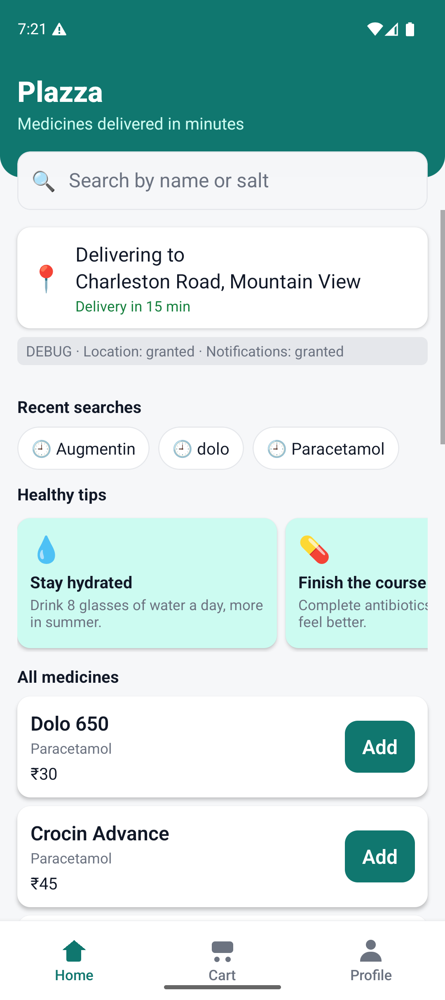
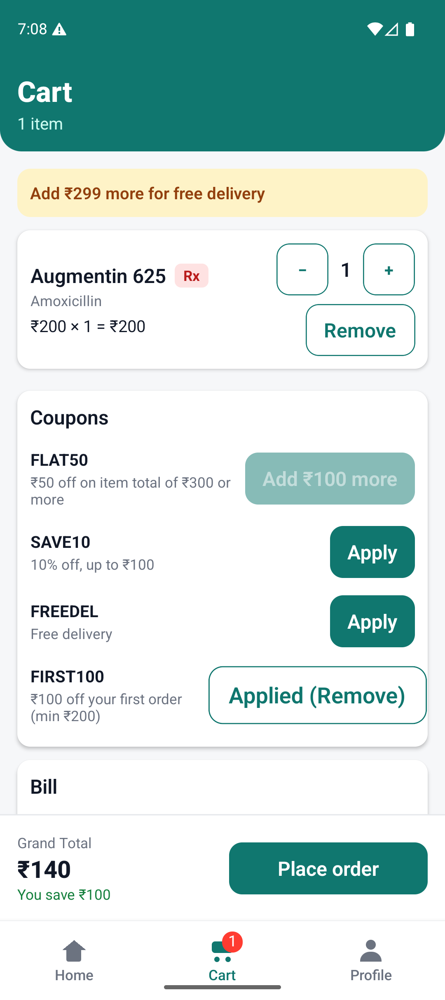
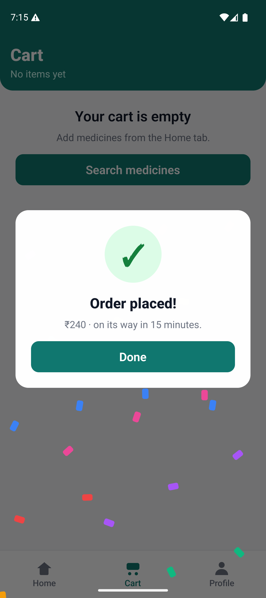
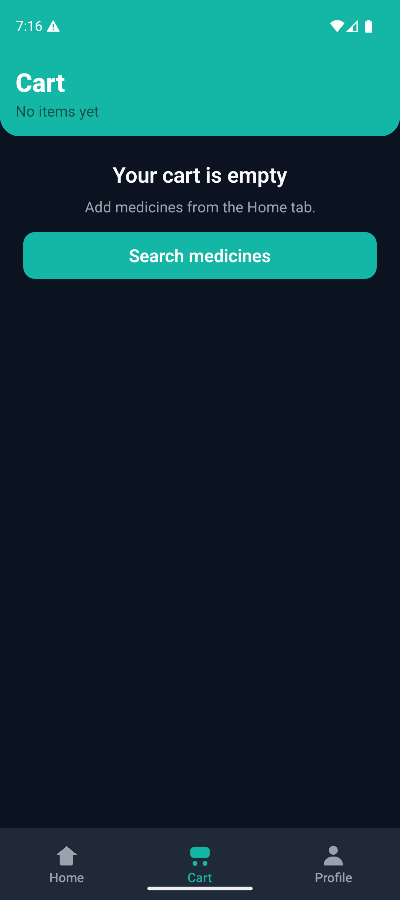

# Plazza

Medicines delivered in minutes — a React Native (Android) take-home app: permissions, medicine search, a persistent cart and a coupon engine, with login, dark mode and a small design system.

<p>
  
  
  
  
</p>

## Download the APK

Debug builds that run without Metro. Needs Android 13 or newer. Pick the one for your device's CPU:

| Device | File |
|---|---|
| Most Android phones (2017+) | [`apk/plazza-arm64-v8a-debug.apk`](apk/plazza-arm64-v8a-debug.apk) |
| Older 32-bit phones | [`apk/plazza-armeabi-v7a-debug.apk`](apk/plazza-armeabi-v7a-debug.apk) |
| Android emulator (x86_64) | [`apk/plazza-x86_64-debug.apk`](apk/plazza-x86_64-debug.apk) |
| Android emulator (x86) | [`apk/plazza-x86-debug.apk`](apk/plazza-x86-debug.apk) |

```bash
adb install apk/plazza-arm64-v8a-debug.apk
```

Login: any name + 10 digit phone, password **1111** (or continue as guest).

## Features

- Splash, mock login / guest mode, persistent session
- Location + notification permissions with granted / denied / blocked handling and Settings deep link
- Delivery place name from GPS
- Search by name or salt with empty / loading / no-results states, recent searches, browse all, health tips
- Medicine detail sheet
- Cart with quantity caps, Rx badges, persistence, bill breakdown, delivery fee rule
- Coupons with reasons, auto-removal toast, one-time FIRST100
- Mock place order (login required) with confetti, order history
- Profile with dark / light theme
- Responsive layout, rotation, safe areas, accessibility labels

See [NOTES.md](NOTES.md) for the tech stack and the full functionality list.

## Run locally

Requirements: Node 18+, JDK 17, Android SDK with an emulator or device on **Android 13+ (API 33)**. The app's `minSdkVersion` is 33, `targetSdkVersion` 35.

```bash
npm install

# terminal 1
npx react-native start

# terminal 2
npx react-native run-android --no-packager
```

Useful emulator commands:

```bash
adb emu geo fix 77.2090 28.6139        # fake location
adb shell pm clear com.plazza          # reset to first launch
adb shell pm revoke com.plazza android.permission.ACCESS_FINE_LOCATION
```

## Test and lint

```bash
npm test          # Jest: 51 tests over logic and stores
npx eslint src    # lint
```

## Build APKs

```bash
npm run apk          # single APK, all ABIs → android/app/build/outputs/apk/debug/app-debug.apk
npm run apk:split    # one APK per ABI  → android/app/build/outputs/apk/debug/app-<abi>-debug.apk
```

Both pass `-PbundleInDebug`, which bundles the JavaScript so the APK runs without Metro.

## Project layout (feature based)

```
src/
  app/App.js                 root: splash → login gate → tabs (Home, Cart, Profile)
  features/
    auth/                    LoginScreen, authStore, components/LoginForm, LoginModal
    home/                    HomeScreen, search.js (pure), searchStore, healthTips,
                             components/MedicineDetailModal, HealthTips
    cart/                    CartScreen, cart.js / bill.js / coupons.js (pure), cartStore,
                             components/BillCard, CouponList
    permissions/             permissionStore, permissionStatus.js (pure), components/PermissionBanner
    profile/                 ProfileScreen
  shared/
    components/              design system: AppText, Button, Card, Input, Chip, SectionTitle,
                             EmptyState, RxBadge, QtyStepper, MedicineRow, ScreenHeader,
                             SplashScreen, SuccessOverlay, Bounce, FadeIn, TabIcon
    theme/                   theme.js (tokens), responsive.js, themeStore (light / dark)
    storage/                 loadData / saveData (versioned, never throw)
    services/                geocode.js, toast.js
    data/                    catalog.json + catalog.js
__tests__/                   Jest tests
apk/                         downloadable debug APKs per ABI
screenshots/                 app screenshots
```

## Code rules

1. Features own their screen, store and logic; shared code lives in `src/shared`. Features never import each other.
2. Logic files are pure (no React, no storage): `cart.js`, `bill.js`, `coupons.js`, `search.js`, `permissionStatus.js`.
3. Stores (zustand) connect logic + storage + toast. Selectors return single values.
4. Screens and components only render and call store actions. No prices or coupon rules in UI.
5. Every color, spacing, radius and font size comes from `shared/theme/theme.js`; components use `useColors()` + `getStyles(colors)`.
6. Reuse `Card`, `Input`, `Chip`, `Button`, `AppText`, `SectionTitle`, `EmptyState` before writing new UI.
7. Every touchable has `accessibilityRole` and `accessibilityLabel`, minimum 48 dp.

## Where to change what

| Change | File |
|---|---|
| New coupon | `src/shared/data/catalog.json` (or a new rule type in `src/features/cart/coupons.js`) |
| New bill line | `src/features/cart/bill.js` + `src/features/cart/components/BillCard.js` |
| Search sorting | `src/features/home/search.js` |
| Colors / fonts | `src/shared/theme/theme.js` |
| New screen | `src/features/<name>/` + a `Tab.Screen` in `src/app/App.js` |
